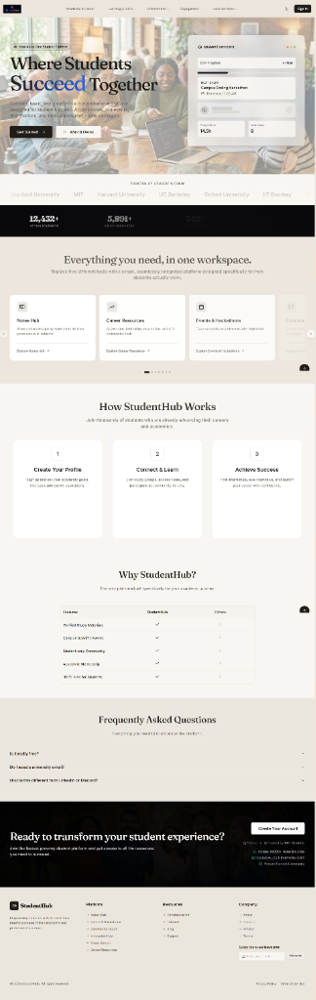
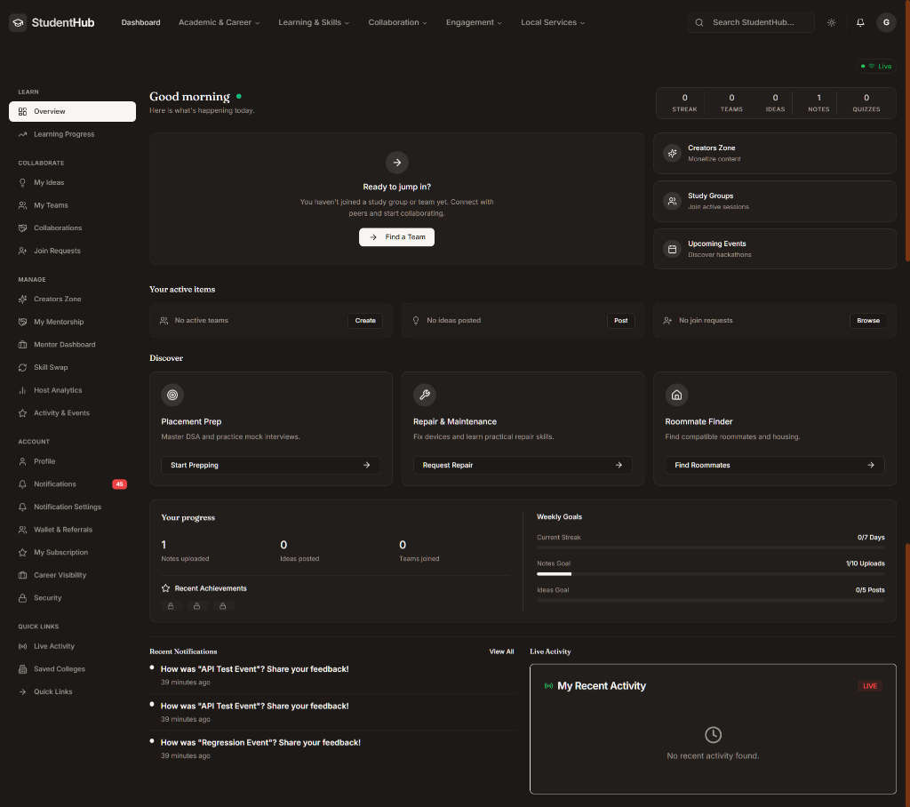
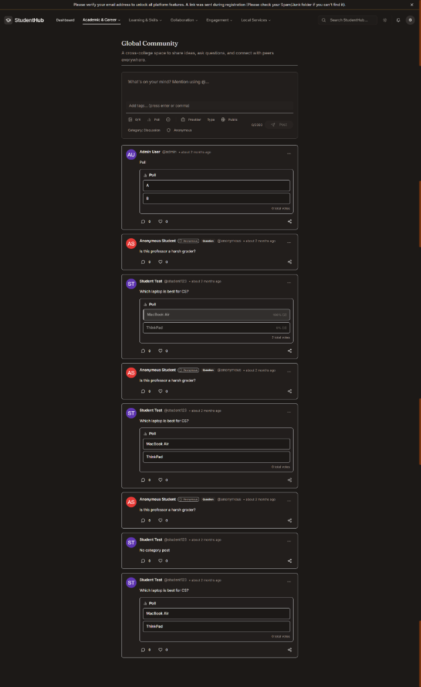
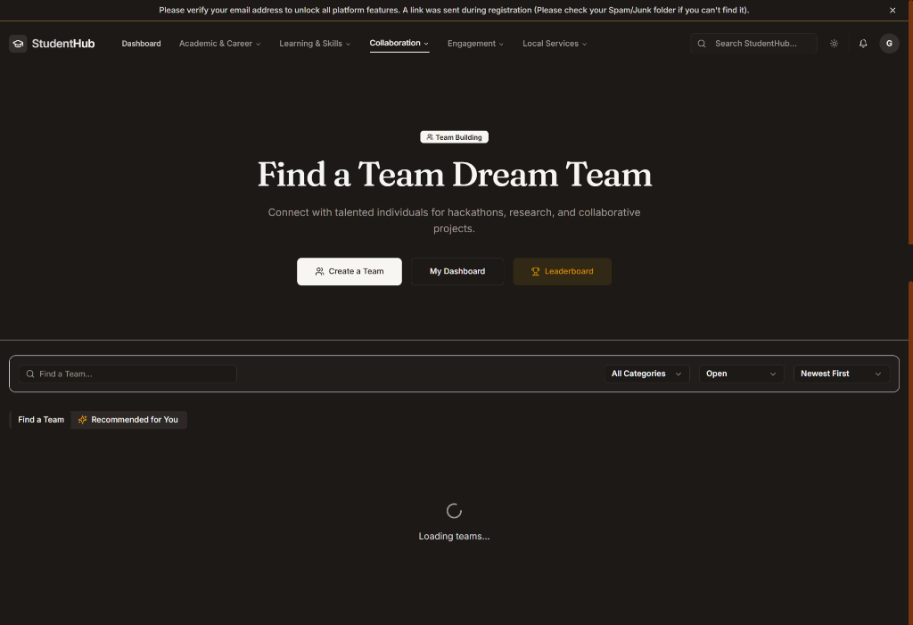
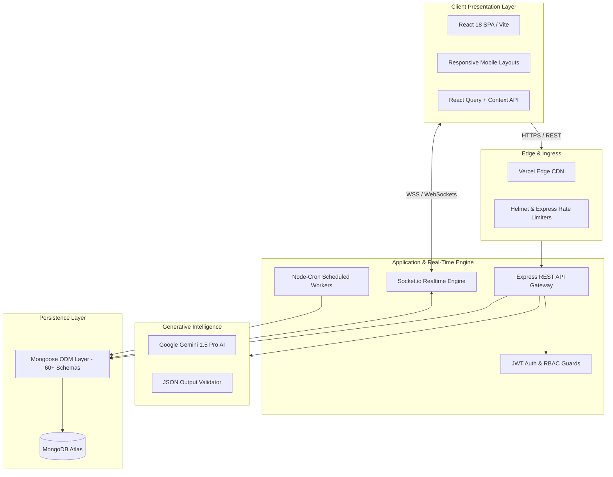
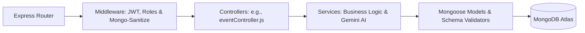
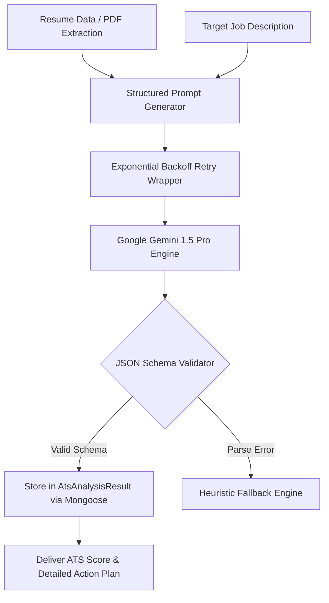
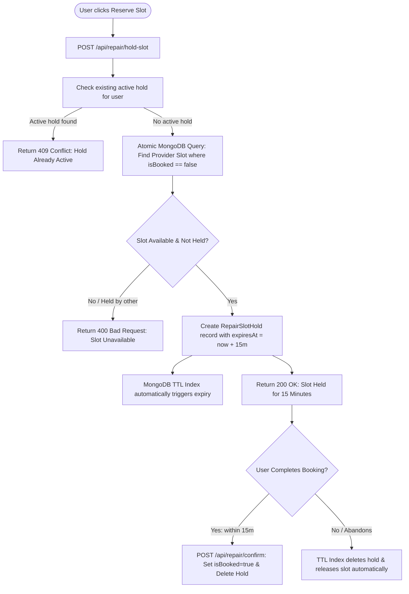
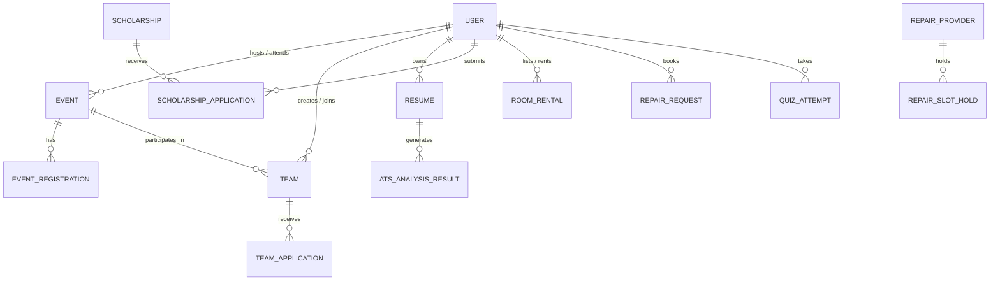

<div align="center">

# StudentHub

### Modular Full-Stack Campus & Career Acceleration Platform

[](https://www.typescriptlang.org/)
[](https://react.dev/)
[](https://vitejs.dev/)
[](https://nodejs.org/)
[](https://expressjs.com/)
[](https://www.mongodb.com/)
[](https://mongoosejs.com/)
[](https://socket.io/)
[](https://ai.google.dev/)
[](https://tailwindcss.com/)
[](https://www.docker.com/)
[](https://opensource.org/licenses/MIT)

</div>

---

## 1. Project Title
**StudentHub (Platform Blueprint)**

## 2. One-Sentence Description
StudentHub is a modular full-stack web application engineered to unify fragmented university lifecycles?bringing event discovery, hackathon team formation, AI-powered placement preparation, verified campus housing, and real-time virtual classrooms into one cohesive ecosystem.

## 3. Live Demo
- ?? **Production Web Application**: [https://platform-blueprint.vercel.app/](https://platform-blueprint.vercel.app/)
- ?? **Source Code Repository**: [https://github.com/sandeep-kumar-270904/platform-blueprint](https://github.com/sandeep-kumar-270904/platform-blueprint)
- ?? **Explore Access**: Browse public event hubs, community discussions, and housing without authentication, or sign in to test real-time collaboration rooms and AI mock interviews.

## 4. Screenshots

<div align="center">
  
  
  
  
</div>

## 5. Problem
Modern university students face severe fragmentation across their academic, professional, and residential milestones:
- **Platform Fatigue**: Students must juggle disconnected platforms for hackathons, career prep, hostel searches, and course discussions.
- **Team Discovery Bottlenecks**: Finding peer collaborators with complementary technical stacks (e.g., frontend + ML + UI/UX) relies on word-of-mouth or unorganized chat groups.
- **Career Preparation Blindspots**: Students often submit non-ATS-compliant resumes and enter placement drives without realistic technical mock interview feedback.
- **Housing Opacity & Booking Conflicts**: Off-campus rentals suffer from unverified listings, fake brokers, and concurrency race conditions during peak booking periods.

## 6. Solution
StudentHub centralizes these isolated workflows into a unified, high-performance platform:
- **Algorithmic Team Hunt**: Matches students for hackathons and projects based on required skills, availability, and verified experience.
- **AI-Powered Career Accelerator**: Integrates Google Gemini 1.5 Pro to deliver real-time ATS resume scoring, keyword gap analysis, and interactive mock interview practice.
- **Real-Time Collaboration**: Powers interactive virtual classrooms, live whiteboard streaming, and low-latency buzzer quiz tournaments via Socket.io.
- **Verified Housing & Services**: Provides verified hostel listings, roommate compatibility scoring, and atomic slot holds to eliminate booking race conditions.

## 7. Key Features
- **JWT Authentication & Granular RBAC**: 5 distinct roles (`student`, `mentor`, `club_lead`, `recruiter`, `admin`) with permissioned route guards.
- **AI Placement Engine**: Automated ATS resume evaluation, industry readiness scoring, and domain-tailored technical mock interviews.
- **Team Matchmaking (Team Hunt)**: Skill-gap compatibility algorithms to assemble balanced hackathon and research teams.
- **Live Virtual Classrooms**: WebSockets-driven interactive sessions with real-time synchronized whiteboards, buzzer tournaments, and live Q&A.
- **Concurrency-Safe Slot Reservations**: Atomic MongoDB reservation holds with TTL indexes preventing double-booking during peak traffic.
- **Community & Knowledge Hub**: Peer discussion forums, upvoting, syllabus tracking, notes sharing, and verified campus reviews.

## 8. Architecture

### 8.1 High-Level Design (HLD)



### 8.2 Low-Level Design (LLD): Controller-Service-Repository Pattern



- **Routes**: Define clean REST endpoints, HTTP verbs, and validation middleware chains.
- **Middleware**: Intercepts requests for JWT verification, role-based access checks, payload sanitization, and rate limits.
- **Controllers**: Orchestrates request validation, extracts parameters, and structures JSON responses.
- **Services**: Encapsulates core business logic, AI prompt orchestration, and mathematical score calculations.
- **Mongoose Models**: Enforces strict schema validation, lifecycle pre/post hooks, and compound indexes across 60+ collections.

### 8.3 Machine Learning & AI Pipeline



**ATS Mathematical Scoring Model:**
$$S_{ATS} = 0.40 \cdot S_{keyword} + 0.30 \cdot S_{impact} + 0.15 \cdot S_{skills} + 0.15 \cdot S_{structure}$$
- $S_{keyword} = \frac{|K_{resume} \cap K_{job}|}{|K_{job}|} \times 100$: Jaccard keyword overlap ratio.
- $S_{impact}$: Ratio of experience bullet points containing quantified impact metrics (percentages, numbers, metrics).
- $S_{skills}$: Canonical skill cluster coverage against the target domain.
- $S_{structure}$: Layout, section taxonomy, and format compliance.

### 8.4 Concurrency-Safe Data Flow (Slot Holds)



### 8.5 Database Design & Core Relationships



**Specialized Indexing Strategy:**
1. **Compound Index**: `events` $\rightarrow$ `{ status: 1, startDate: 1 }` (sub-10ms event filtering).
2. **Text Index**: `events`, `communityposts` $\rightarrow$ `{ title: "text", description: "text" }` (keyword search).
3. **Geospatial `2dsphere` Index**: `repairproviders`, `hostels` $\rightarrow$ `{ location.coordinates: "2dsphere" }`.
4. **TTL (Time-To-Live) Index**: `repairslotholds` $\rightarrow$ `{ createdAt: 1, expireAfterSeconds: 900 }` (auto-deletes expired holds).

## 9. Tech Stack

| Layer | Technologies | Role & Justification |
|:---|:---|:---|
| **Frontend UI** | **React 18, TypeScript, Vite 5.4** | Modern component architecture, strict compile-time types, and native ESM build speed. |
| **Styling & UI Kit** | **Tailwind CSS 3.4, Shadcn UI, Radix UI** | Accessible, responsive design system with zero runtime CSS-in-JS overhead. |
| **Backend Runtime** | **Node.js 20+, Express.js 4.x** | Non-blocking event-driven I/O loop providing high throughput for concurrent REST and WebSocket traffic. |
| **Database & ODM** | **MongoDB Atlas, Mongoose 9.x** | High-performance document database with Mongoose ODM enforcing schemas, hooks, and indexes across 60+ models. |
| **Real-Time Engine** | **Socket.io 4.x** | Multiplexed WebSocket channels for live quiz buzzers, collaborative whiteboards, and real-time chat. |
| **AI Engine** | **Google Gemini 1.5 Pro** | Context-aware resume evaluation, ATS analysis, and structured JSON output mode. |
| **Testing Suite** | **Jest, Supertest, Vitest, Cypress** | Automated unit, integration, component, and end-to-end test suites. |
| **DevOps & Cloud** | **Docker, GitHub Actions, Vercel, Render** | Automated CI/CD pipeline, containerized deployments, and edge CDN distribution. |

## 10. Engineering Decisions

- **MongoDB with Mongoose ODM**: Selected for its natural alignment with polymorphic student profiles, multi-format event submissions, and dynamic team structures. Mongoose provides robust schema validation, middleware hooks, and compound/geospatial index management.
- **Controller-Service-Repository Pattern**: Separates HTTP routing from core business logic and database models, ensuring codebase maintainability, reusability, and simple unit testing.
- **Socket.io for Low-Latency Real-Time**: Chose WebSockets with fallback polling to power virtual classroom polling, live buzzer battle sync, and synchronized canvas whiteboards without the overhead of HTTP polling.
- **Atomic Concurrency Locks with TTL**: Avoided heavy distributed lock managers by leveraging MongoDB atomic operators (`$set`, `$inc`) paired with native MongoDB TTL indexes for temporary 15-minute slot holds.
- **Gemini Structured Output Mode**: Configured prompt templates to enforce strict JSON schemas directly from Gemini 1.5 Pro, eliminating brittle regex-based parsing of AI responses.

## 11. Setup

### Prerequisites
- Node.js `v20.x` or higher
- npm `v10.x` or higher
- MongoDB instance (local or MongoDB Atlas connection string)

### Quickstart
```bash
# 1. Clone the repository
git clone https://github.com/sandeep-kumar-270904/platform-blueprint.git
cd platform-blueprint

# 2. Install root and frontend dependencies
npm install

# 3. Install backend dependencies
cd backend && npm install && cd ..

# 4. Run both frontend and backend concurrently
npm run start:all
```
*Frontend runs on `http://localhost:8080`, Backend runs on `http://localhost:5000`.*

## 12. Environment Variables

Create a `.env` file in the `backend/` directory:

```env
# Server Configuration
PORT=5000
NODE_ENV=development

# Database Configuration (Mongoose)
MONGO_URI=mongodb+srv://<username>:<password>@cluster0.mongodb.net/studenthub?retryWrites=true&w=majority

# Authentication
JWT_SECRET=your_super_secret_jwt_key_here

# AI Services
GEMINI_API_KEY=your_google_gemini_api_key

# Client URL (for CORS)
CLIENT_URL=http://localhost:8080
```

## 13. Testing
Automated testing is integrated across both frontend and backend to ensure reliability:

```
platform-blueprint/
??? backend/tests/
?   ??? auth.test.js           # Registration, password hashing, and JWT issuance
?   ??? events.test.js         # Event filtering, creation, and registration
?   ??? teams.test.js          # Team matchmaking and skill compatibility
?   ??? reservations.test.js   # Concurrency-safe slot reservation logic
?   ??? resume.test.js         # ATS response structure and score parsing
?   ??? health.test.js         # API gateway ping and database readiness
??? src/tests/
?   ??? auth.test.tsx          # Login and register form validation
?   ??? events.test.tsx        # Event list filtering and card rendering
??? .github/workflows/ci.yml   # Automated CI pipeline on push
```

**Running Tests Locally:**
```bash
# Run Frontend Component Tests (Vitest)
npm run test

# Run Backend Unit & Integration Tests (Jest)
cd backend && npm test
```

## 14. Deployment
- **Frontend**: Hosted on [Vercel](https://vercel.com/) with continuous deployment triggered on every push to `main`.
- **Backend**: Containerized with Docker and hosted on [Render](https://render.com/) with automatic rebuilds.
- **Database**: Managed on [MongoDB Atlas](https://www.mongodb.com/atlas) with automated backups, monitoring, and IP access restrictions.
- **CI/CD Pipeline**: GitHub Actions automatically runs linter, frontend unit tests, backend integration tests, and production build checks before merging.

## 15. Security
Security measures include Helmet, rate limiting, input validation, authentication controls, and secure configuration practices:
- **NoSQL Injection Defense**: `express-mongo-sanitize` strips `$` and `.` operators from request bodies, queries, and params.
- **Cross-Site Scripting (XSS)**: Handled via React JSX automatic escaping, `xss-clean`, and DOMPurify for user-generated markdown.
- **Rate Limiting**: `express-rate-limit` enforces strict request ceilings on authentication, password reset, and AI endpoints to mitigate brute-force and resource exhaustion attacks.
- **HTTP Security Headers**: `helmet` enforces Content Security Policy (CSP), HTTP Strict Transport Security (HSTS), and `X-Frame-Options`.
- **Stateless JWT & RBAC**: Cryptographically signed tokens with expiration; authorization guards enforce strict role permissions across endpoints.

## 16. Limitations
- **In-Memory Background Scheduler**: `node-cron` jobs currently execute in the application process. Moving to distributed multi-instance deployments requires offloading background jobs to BullMQ backed by Redis.
- **Single-Node WebSockets**: Socket.io rooms currently rely on server instance memory. Horizontal scaling across multiple backend nodes requires attaching `@socket.io/redis-adapter`.
- **Third-Party AI Dependency**: ATS scoring turnaround times depend on Google Gemini API availability and rate limits.

## 17. Future Work
- **Mobile Native Application**: Developing React Native mobile clients for iOS and Android.
- **Redis Pub/Sub Layer**: Integrating Redis for distributed WebSocket synchronization across clustered backend instances.
- **Smart Escrow Payments**: Integrating Stripe Connect for secure peer-to-peer housing deposits and verified event ticketing.
- **Alumni Mentorship Network**: Expanded booking engine with calendar sync (Google Calendar / Outlook integration).

## 18. My Role

**Full-Stack Developer**

Designed and implemented the platform end-to-end:
- **Frontend Architecture**: Built the responsive UI with React 18, TypeScript, Tailwind CSS, and Shadcn UI.
- **Backend API Engineering**: Developed RESTful APIs, JWT authentication, and role-based access control with Node.js and Express.
- **Database Design**: Modeled 60+ schemas and configured compound, geospatial, and TTL indexes using **MongoDB and Mongoose**.
- **Real-Time Systems**: Implemented WebSocket channels for live quiz tournaments and interactive whiteboard streaming with Socket.io.
- **AI Integrations**: Engineered Gemini 1.5 Pro prompt pipelines with structured JSON schema outputs for resume ATS scoring.
- **DevOps & Testing**: Built Docker containers, wrote Jest and Vitest test suites, and configured GitHub Actions CI/CD workflows.
